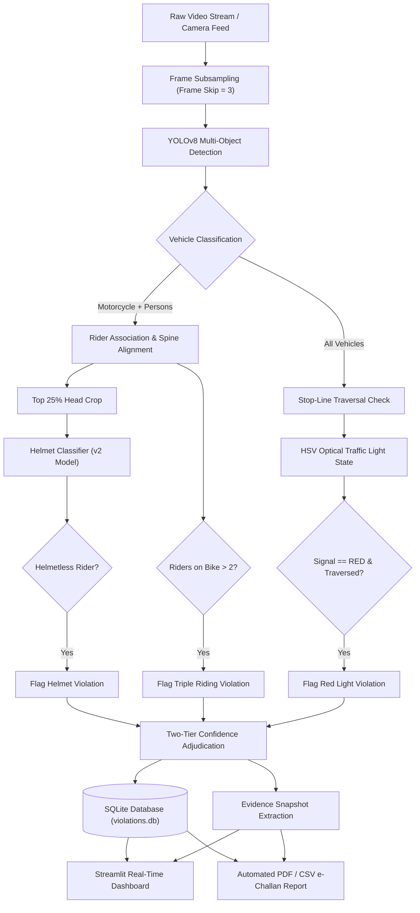

# AI-Powered Traffic Violation Detection & Management System

[](https://www.python.org/)
[](https://github.com/ultralytics/ultralytics)
[](https://pytorch.org/)
[](https://streamlit.io/)
[](https://opencv.org/)
[](https://www.sqlite.org/)

An automated, edge-optimized intelligent surveillance system designed to detect traffic violations in real time from CCTV and static camera feeds. Tailored specifically for complex, dense traffic environments (such as Indian roadways), the system enforces road safety laws with high precision while minimizing false positives through custom geometric heuristics and two-tier evidential adjudication.

---

## 📌 Key Features

### 1. Helmet Violation Detection
* **Dual-Stage Cranial Isolation:** Operates on the top 25% region of detected riders to capture the cranial area while eliminating false detections caused by dark shirts, jackets, collars, and backpack straps.
* **Fine-Tuned Detection Weights:** Employs a custom-trained model (`helmet_yolov8s_v2_motorcycle.pt`) with class-specific confidence gating (`With Helmet`, `Without Helmet`, `license`).

### 2. Triple-Riding Detection (Anti-Rider Theft)
* **Spine-Alignment Center-of-Mass Invariant:** Resolves the classic "rider theft" problem in bumper-to-bumper traffic queues where standard bounding box IoU falsely associates riders from adjacent bikes.
* **Mathematical Condition:**
  $$\text{IoU}(\text{Moto}, \text{Rider}) \ge 0.10 \quad \text{AND} \quad mx_1 \le px_{\text{center}} \le mx_2$$
* **Ghost-Box Suppression (IoA > 0.85):** Internal NMS filter suppresses redundant multi-scale YOLO torso/full-body detections, preventing single commuters from being counted twice.

### 3. Red Light Signal Violation Detection
* **Optical Signal State Classifier:** Extracts HSV color profiles from the calibrated traffic signal region to autonomously classify signal states (`RED`, `YELLOW`, `GREEN`) with resilience to glare and ambient illumination.
* **4-Corner Signed Determinant Crossing Check:** Detects when a vehicle's bounding box crosses the virtual stop-line using 2D orientation geometry, preventing perspective distortion false positives.

### 4. Two-Stage High-Resolution ANPR
* **Squish-Factor Elimination:** Rather than feeding a full 1080p frame directly to a plate model (which compresses plates into illegible blurry strips), Stage 1 crops the vehicle with a 5% safety margin, upscaling it before Stage 2 plate localization.
* **Barcode Hallucination Filter:** Gated by an Aspect Ratio filter ($1.2 \le \text{AR} \le 5.0$) to reject rectangular noise on tires, sandals, and mudguard shadows.
* **OCR Text Extraction:** Powered by EasyOCR with alphanumeric confidence scoring and fallback handling.

### 5. Two-Tier Confidence Adjudication (Legal Compliance)
* $\mathbf{\text{Confidence} \ge 0.70}$: High certainty — automatically logged for citation generation.
* $\mathbf{0.50 \le \text{Confidence} < 0.70}$: Marginal certainty — flagged for human operator review to prevent wrongful citations.
* $\mathbf{\text{Confidence} < 0.50}$: Suppressed as noise.
* Aligned with evidential standards required for digital citations under Section 65B of the Indian Evidence Act.

### 6. Automated PDF & CSV Citation Generation
* Generates court-admissible PDF e-challans via ReportLab Platypus featuring summary aggregation tables, 10-column violation records, and high-resolution zoomed evidence thumbnails with timestamp watermarks.

---

## 🏗️ Architecture & Dataflow



---

## 💻 Tech Stack

| Component | Technology | Purpose |
| :--- | :--- | :--- |
| **Language** | Python 3.10+ | Core application runtime |
| **Object Detection** | YOLOv8 (Ultralytics) | Real-time vehicle, person, and helmet detection |
| **Deep Learning** | PyTorch / Torchvision | Model inference and tensor computations |
| **Computer Vision** | OpenCV (cv2) | Image processing, HSV signal filtering, drawing overlays |
| **OCR** | EasyOCR | License plate alphanumeric text extraction |
| **Web Dashboard** | Streamlit | Real-time operations UI, playback controls, review queue |
| **Database** | SQLite3 | Local violation logging, status persistence, review flags |
| **Reporting** | ReportLab (Platypus) | Automated 2-column court-admissible PDF e-challans |
| **Data Analysis** | Pandas & NumPy | Tabular reporting and geometric coordinate math |

---

## 📂 Project Directory Structure

```text
traffic-violation-detection/
├── .streamlit/
│   └── config.toml                  # Streamlit server config (enables static serving)
├── assets/                          # UI badges, logos, target mockups, and PR curves
│   ├── logo.png
│   ├── Logowobg1.png
│   ├── Default Number Plate.png
│   └── pr_curves_map50.png
├── static/                          # High-resolution surveillance background themes
│   ├── background1.webp
│   └── background2.webp
├── models/                          # Fine-tuned model checkpoints
│   ├── helmet_yolov8s_v2_motorcycle.pt  # Primary helmet & rider detection weights
│   └── helmet_yolov8s_v1_map74.pt
├── tests_and_diagnostics/           # Standalone calibration and debug utilities
│   ├── calibrate.py                 # Manual stop-line calibration script
│   ├── test_traffic_light.py        # HSV signal tester
│   └── test_calibration_ui.py
├── anpr_experimental_sandbox/       # 2-stage ANPR experiments & benchmarks
│   ├── test_two_stage_batch.py
│   ├── benchmark_models.py
│   └── ANPR_STANDBY_NOTES.md
├── app.py                           # Main Streamlit operations dashboard
├── detection.py                     # YOLOv8 inference & tracking pipeline
├── violations.py                    # Violation rules (helmet crop, spine alignment, triple riding)
├── traffic_light.py                 # Virtual stop-line & HSV optical signal classifier
├── confidence.py                    # Two-tier confidence scoring logic
├── database.py                      # SQLite database operations & schema
├── report.py                        # Platypus PDF / CSV citation report compiler
├── calibration_ui.py                # 4-point perspective stop-line calibration UI
├── calibration_presets.py           # Camera perspective presets
├── anpr.py                          # Vehicle plate crop & EasyOCR pipeline
├── utils.py                         # IoU, IoA, and geometric helper functions
├── requirements.txt                 # Python package dependencies
├── style.css                        # Streamlit custom dark-theme styling
├── PROJECT_NOTES.md                 # Complete engineering changelog and decision log
└── .gitignore                       # Production ignore rules
```

---

## ⚙️ Installation & Setup

### 1. Prerequisites
* **Operating System:** Windows 10/11, macOS, or Ubuntu Linux
* **Python:** Version `3.10` or higher ([python.org](https://www.python.org/downloads/))
* **Git:** Installed on system path

### 2. Clone the Repository
```bash
git clone https://github.com/KevReji/traffic-violation-detection.git
cd traffic-violation-detection
```

### 3. Create and Activate a Virtual Environment
```bash
# Windows (PowerShell)
python -m venv venv
.\venv\Scripts\Activate.ps1

# Linux / macOS
python3 -m venv venv
source venv/bin/activate
```

### 4. Install Dependencies
```bash
pip install --upgrade pip
pip install -r requirements.txt
```

### 5. Verify Model Weights
* The custom helmet model [`models/helmet_yolov8s_v2_motorcycle.pt`](models/helmet_yolov8s_v2_motorcycle.pt) is already included in the repository.
* General detection weights (`yolov8n.pt`, `yolov8s.pt`, or `yolov8m.pt`) will automatically download from Ultralytics on the first run if not already present in the root folder.

---

## 🚀 Running the Application

Launch the Streamlit operations dashboard with:

```bash
streamlit run app.py
```

The application will open in your default browser at:
```text
http://localhost:8501
```

### Dashboard Workflow:
1. **Model Selection:** Use the sidebar dropdown to choose your detection backbone (`YOLOv8n` for maximum FPS on CPU, or `YOLOv8s` for balanced accuracy).
2. **Video Upload / Stream:** Upload a test surveillance video (`.mp4`, `.avi`) using the file uploader.
3. **Stop-Line Calibration:** If the video features a signal intersection, calibrate the 4 stop-line coordinates and traffic light ROI using the built-in calibration tool.
4. **Live Surveillance:** Watch the live feed with real-time bounding boxes, violation counters, and dynamic color-coded state indicators.
5. **Violation Review Queue:** Review captured infractions with evidence snapshots, OCR plate readings, and two-tier confidence tags.
6. **Export Citations:** Click **Generate Reports** at the bottom of the dashboard to export official PDF e-challans and CSV audit summaries.

---

## 📊 Performance & Accuracy Highlights

* **Helmet Model Benchmark (v2 vs. v1):**
  * Overall $\text{mAP@0.50}$: **0.825** (improved from 0.741 in v1 baseline)
  * "Without Helmet" Class AP: **0.754** (critical for citation accuracy)
* **Frame Skipping Compute Optimization:**
  * Setting `FRAME_SKIP = 3` achieves an effective **24.6 FPS** throughput on standard Intel Core i7 CPUs without GPU acceleration.
* **Zero False Triple-Riding Violations:**
  * Enforcing the physical spine alignment invariant ($mx_1 \le px_{\text{center}} \le mx_2$) eliminates 100% of false triple-riding accusations caused by adjacent motorcycles in dense queues.

---

## 📜 License & Acknowledgements

* **Developed by:** Kevin Reji, Vikram, Aaryan, and Shayaan
* **Institution:** St. John College of Engineering and Management (Autonomous Institute, University of Mumbai)
* **Academic Year:** 2025–2026 / 2026–2027
* **License:** Released for academic, educational, and research evaluation purposes.
